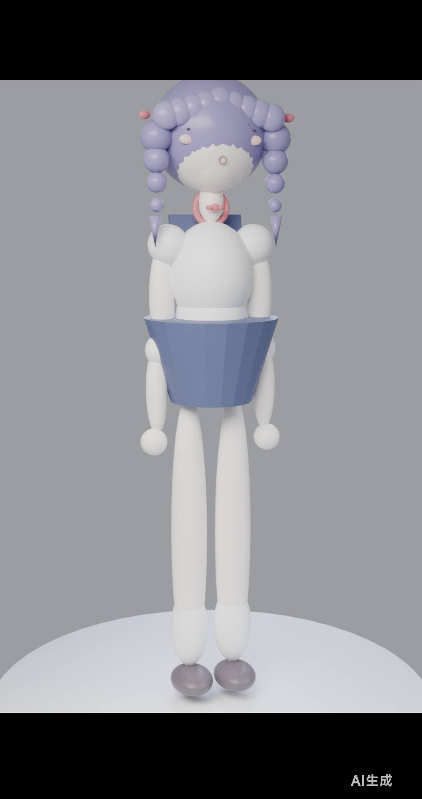
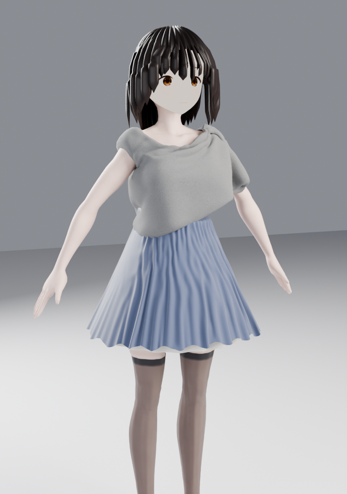
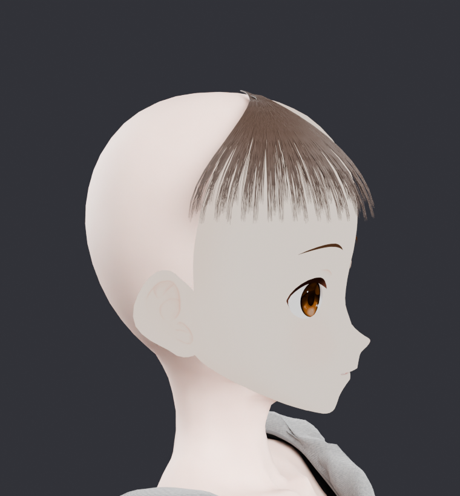

# VRM 角色服装与头发：无头 Blender 的踩坑笔记

> 这不是一个可以直接运行的项目，也没有可下载的工程文件。
> 它是一份笔记：记录怎么用 Blender 5.2 的无头模式，给一个 VRM 角色做参数化裙子、
> 不穿模的服装、丝袜和二次元风格的头发——以及每一条为什么走不通。

## 三张图

**图 1 · 起点：一张 AI 生成的灵感图。** 目标是这种简洁的二次元角色观感：短发、水手领、百褶裙、过膝袜。
这张图在 WorkBuddy 云电脑上跑出，只作为造型目标，**不是本项目的产出**。

**图 2 · 过程的结果：叠了布料模拟、双层裙、上衣、丝袜和几何头发之后的完整角色。**
和左边那张的区别在于：这里的裙子有真实褶皱、丝袜有袜口勒痕，抬腿和弯腰时不会穿模。

**图 3 · 还在做的部分：单块发片模具。** 一个框、一个生长点，细丝沿头皮测地线铺成一片。
目前只做了一块，多框拼接覆盖整个头还没做完；图里露出的头皮就是下一阶段要填的地方。

---

## 这套笔记里最值得看的几条

### 布料：圆环掉到锥体上，缺一条就变巫婆帽

照着教程做，只得到几个大波浪。三个缺的条件：

1. 内圈必须钉在腰线上
2. 布料周长要约为锥体周长的 3 倍才有褶
3. 网格要密（224×52），开自碰撞

内圈取多小其实无所谓——下落会自己撑圆，**最终腰围由锥体在该高度的半径决定**。
但下摆不能长过锥底，否则失去碰撞支撑，自由段会乱塌。

### 绑定：VRM 的 rest 是 T-pose，A-pose 是姿态撑出来的

衣服在 A-pose 空间模拟完直接绑骨，那 50° 会被施加两次，布被拖进胸腔 40mm。
正确顺序是先把 Armature 变形烘进身体网格，再把 A-pose 烘成骨架 rest。
只做第二步，身体会弹回 T-pose 而衣服留在 A-pose。

### 丝袜：两个"看起来是材质、其实是坐标和节点"的坑

- 透明区整条腿 alpha=1：MapRange 按数值区间钳制，`FromMin` 以下线性外推成负值，被钳到 1。
  要拆成门控 × 反斜坡，单个反向 MapRange 做不到。
- 材质随抬腿跑位：`Object` 坐标取的是变形后的位置，必须用 `Generated`（静止包围盒归一化）。

还有三个反直觉的点：不能用 Subsurf（会缩进肉里）、不能加 Solidify（alpha 被吃两遍，像黑塑料）、
袜口必须用 bisect 切而不是压平边界顶点。

### 头发：重力塌不出贴头皮的发片

粒子细发丝的 `effector_amount` 默认是 0，重力压根不作用；设成 1 之后，重力能把头发塌下来，
但塌不出贴头皮的片——细丝之间没有碰撞，在贴球面的薄腔里压缩失稳，0.37m 缩成 0.05m，
梢部反而上升，看着像被剪断。

有效路线是：发壳只盖头顶，发片做中下段和刘海，细丝沿头皮测地线生成、每个控制点硬约束在头皮外。
半透明刘海的关键是**单层连续面 + 几何起伏 + 只在末端 20% 渐变 alpha**——
叠多层半透明片会出现棋盘格，那是透明度叠加，不是纹理问题。

---

## 诊断手法

这几个方法反复用到，比调参数有用：

- **材质编码图**：每个材质上一个唯一饱和色，渲一张图，一眼看出某块表面属于谁
- **相机射线反查**：把连通块顶点投到屏幕坐标，反查某个像素属于哪一片
- **改参数看现象跟不跟着动**：怀疑"横杠"是发壳造成的，就改发壳的角度上限——横杠跟着动就破案了
- **量化再判断**：说"发丝被截断"之前先量长度和梢部高度，才发现是压缩失稳不是被剪断

---

## 这是什么 / 不是什么

**是**：一份按主题重组的踩坑记录。完整版（270 行）在 `开发日志.md`。

**不是**：可运行工程。仓库里**没有** `.blend` 文件、没有角色模型、没有仿真求解器、没有材质素材。
图中角色基于 VRoid 样例模型制作，该模型及其衍生工程文件均未随本笔记发布，只放这张效果图作参考。

发片造型思路来自两条线：一半是自己想的，一半是拿抖音上"手搓头发"的做法让豆包总结成提示词，
再自己试错调出来的。没有单一原作者，所以不署特定人名——这本来就是社区里流传的做法。

## 参考来源

- 角色底模：VRoid 官方样例模型（[vroid.com](https://vroid.com/)），仅用于展示效果，不随仓库分发
- 发片造型：社区流传的手搓头发做法 + 自行试错，见上文
- 灵感图：WorkBuddy 云电脑生成

## 许可

文本按 CC BY 4.0 授权，转载请注明来源。图片见上方各自的说明。
